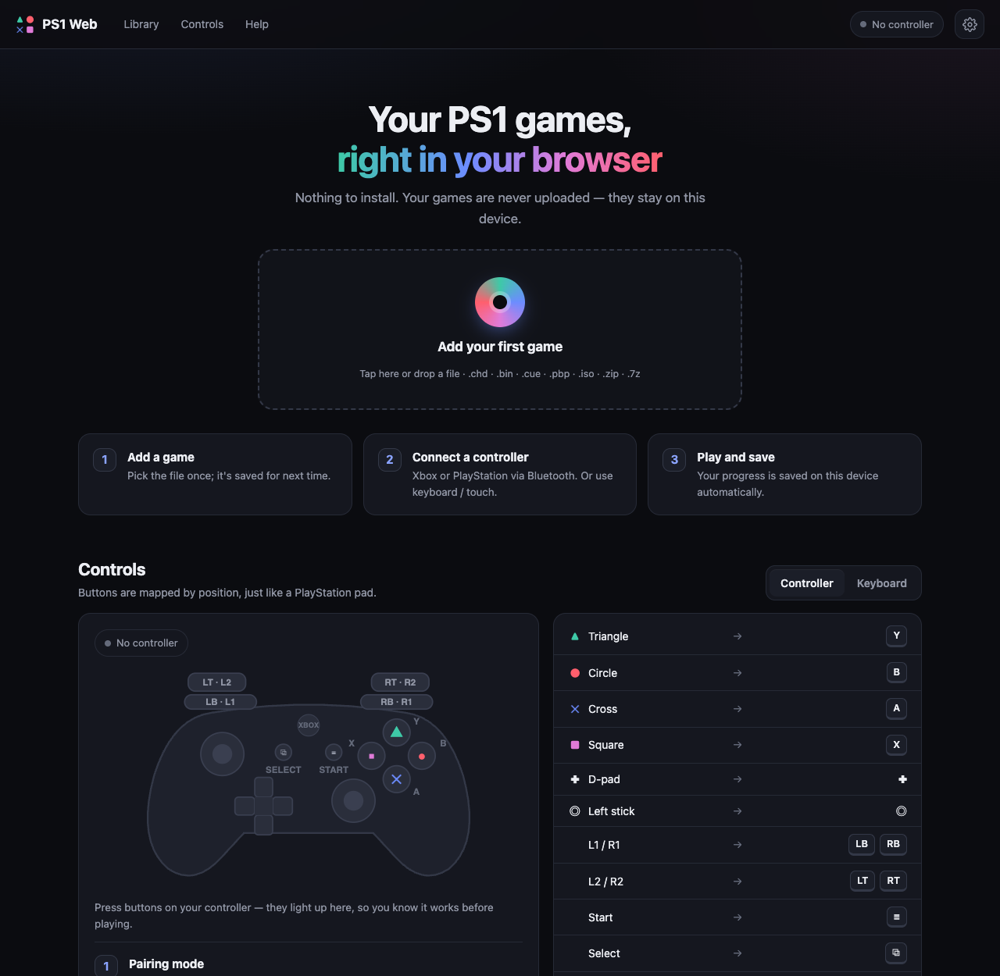

<div align="center">

# ▲ ● ✕ ■ PS1 Web

**Play your PlayStation 1 games in the browser — on your Mac, PC, iPad or phone. No install, no account, no uploads.**

[](https://davidzetadigital.github.io/ps1-web/)
[](https://github.com/davidzetadigital/ps1-web/stargazers)
[](LICENSE)

**[▶ Open PS1 Web](https://davidzetadigital.github.io/ps1-web/)** · [Report a bug](https://github.com/davidzetadigital/ps1-web/issues/new) · [Rate it](https://davidzetadigital.github.io/ps1-web/)

</div>

---

<p align="center"></p>

## ✨ Why PS1 Web?

- **Runs 100% in your browser.** Your games never leave your device — nothing is uploaded anywhere.
- **Add a game once, play forever.** Tap *Add game* or just drag a file onto the page. Next time it's in your library, with a **Continue playing** shortcut for your last game.
- **Controller tester built in.** Press buttons on your Xbox or PlayStation controller and watch them light up on screen before you play.
- **Buttons mapped like a real PS1 pad.** Xbox **A = ✕**, **B = ●**, **X = ■**, **Y = ▲** — no setup needed.
- **Touch controls on iPad and phones**, which hide automatically when a controller connects.
- **Simple settings.** Language, touch buttons, fullscreen on start and image style (sharp, smooth or retro CRT TV).
- **English and Spanish**, picked automatically from your device.
- **Save and Load buttons, always in reach.** One tap to save anywhere and one to go back — saves survive closing the page, and memory card saves are written every few seconds.
- **Left stick works everywhere.** It doubles as a D-pad, so even digital-only PS1 games respond to it.
- **Install it like an app.** Add to Home Screen on iPad/iPhone for a full-screen experience.
- **Optional home library.** Run one tiny Python script and every game in a folder on your computer shows up on every device in your house.
- **Single HTML file.** No build step, no framework, no dependencies to install.

## 🚀 Quick start

### Play online (any device)

1. Open **https://davidzetadigital.github.io/ps1-web/**
2. Tap **Add game** (or drag the file onto the page) and pick your game.
3. Play. Next time, your game is already in the list.

> 💡 **iPad / iPhone:** in Safari tap **Share → Add to Home Screen**. It opens full-screen like an app, and Safari won't clear your games for inactivity.

### Supported formats

| Format | Notes |
|---|---|
| `.chd` | ⭐ Recommended — compressed, single file, lowest memory use |
| `.bin` | Single-track games work on their own (the page creates the `.cue` for you) |
| `.cue` + `.bin` | Select both files together |
| `.pbp` | PSP-style eboot images |
| `.iso` / `.img` | Plain disc images |
| `.zip` / `.7z` | Archives containing any of the above |

### Run your own home library (optional)

Keep all your games in one folder on your computer and play them from any device on your Wi-Fi.

```bash
git clone https://github.com/davidzetadigital/ps1-web.git
cd ps1-web
python3 server.py --lan
```

- Put your games in `~/Downloads/PS1` (or pass `--library /path/to/games`).
- Open `http://localhost:8080` on the computer, or the address printed in the terminal from your phone, tablet or TV browser.
- Drop a BIOS file (`scph1001.bin`, `scph5501.bin`…) from **your own console** into the same folder for maximum compatibility.

Requires only Python 3 — no packages to install.

## 🎮 Controls

| PlayStation | Xbox controller | Keyboard |
|---|---|---|
| ▲ Triangle | Y | S |
| ● Circle | B | C |
| ✕ Cross | A | X |
| ■ Square | X | Z |
| D-pad | D-pad | Arrow keys |
| Left stick | Left stick | I J K L |
| L1 / R1 | LB / RB | Q / E |
| L2 / R2 | LT / RT | W / R |
| Start / Select | Menu ≡ / View ⧉ | Enter / Shift |
| Analog mode on/off | LB + RB + View | Q + E + Shift |
| Save / Load anywhere | Save / Load buttons | 1 / 2 |
| Fast forward | — | Space |

**Connecting a controller via Bluetooth:** turn it on, hold the small pair button until the logo flashes fast, pair it in your device's Bluetooth settings, then press any button with the page open (browsers only detect a controller after a button press).

## ❓ FAQ

<details>
<summary><b>Does it include any games or BIOS?</b></summary>

No, and it never will. Use only backups of games you own, dumped from your own discs. The emulator includes a replacement BIOS, so a real one is optional.
</details>

<details>
<summary><b>The page closes or reloads when loading a game on my iPad.</b></summary>

Older iPads have limited memory. Convert the game to `.chd` (about half the size) with [`chdman`](https://docs.mamedev.org/tools/chdman.html):

```bash
chdman createcd -i "My Game.cue" -o "My Game.chd"
```
</details>

<details>
<summary><b>Where are my saves?</b></summary>

In your browser's storage (IndexedDB) on each device — nothing is uploaded. Memory card saves are written every few seconds and when you leave a game. You can also save anywhere with the **Save** and **Load** buttons in the top bar (or keys `1` / `2`) — those saves are kept even after closing the page. The folder button opens a `.state` or `.srm` save file you downloaded. Clearing website data for this page deletes them. On iPad/iPhone, adding the page to the Home Screen protects them from automatic cleanup.
</details>

<details>
<summary><b>The analog stick doesn't move my character.</b></summary>

The original PS1 pad had no sticks, so many games only read the D-pad. PS1 Web makes the left stick act as a D-pad, so it works in every game (you can turn this off in Settings). The emulator presents a DualShock controller to games; in compatible games, turn on analog mode with `LB + RB + View`.
</details>

<details>
<summary><b>Does the controller vibrate?</b></summary>

Games see a DualShock, so their in-game vibration option can be turned on. The controller won't physically rumble yet, because the web emulator (EmulatorJS) doesn't pass vibration to the browser.
</details>

<details>
<summary><b>My controller isn't detected.</b></summary>

Press any button while the page is open — browsers hide controllers until then. The badge in the top-right corner shows 🎮 when it's connected. An Xbox controller remembers only one Bluetooth device, so re-pair it when switching between devices.
</details>

<details>
<summary><b>Can I play it on my TV?</b></summary>

Yes: mirror your computer with AirPlay or connect it with HDMI, or run `server.py --lan` and open the address in your TV's browser (TV browsers are slower, so a computer is recommended).
</details>

## 🛠 How it works

PS1 Web is a single `index.html` that wraps [EmulatorJS](https://github.com/EmulatorJS/EmulatorJS), which runs the [PCSX ReARMed](https://github.com/libretro/pcsx_rearmed) PlayStation core compiled to WebAssembly. Games you add are stored as files in IndexedDB; nothing is sent to a server. The optional `server.py` serves a game folder and packs `.cue` + `.bin` sets on the fly.

## 🤝 Contributing

Ideas, bug reports and pull requests are welcome!

- 🐛 Found a bug? [Open an issue](https://github.com/davidzetadigital/ps1-web/issues/new) with your device and browser.
- 💡 Have an idea? Tell me in an issue.
- ⭐ Like it? **Star the repo** — it really helps other people find it.

## ⚖️ Legal

This project does not include, link to, or distribute any copyrighted games or BIOS files. PlayStation is a registered trademark of Sony Interactive Entertainment; this project is not affiliated with or endorsed by Sony. Please respect copyright and only play games you legally own.

## 📄 License

[MIT](LICENSE) for the code in this repository. EmulatorJS and PCSX ReARMed are loaded at runtime from the EmulatorJS CDN and keep their own licenses (GPL-3.0 and GPL-2.0).

<div align="center">

**If PS1 Web brought back some memories, give it a ⭐ — thank you!**

</div>
